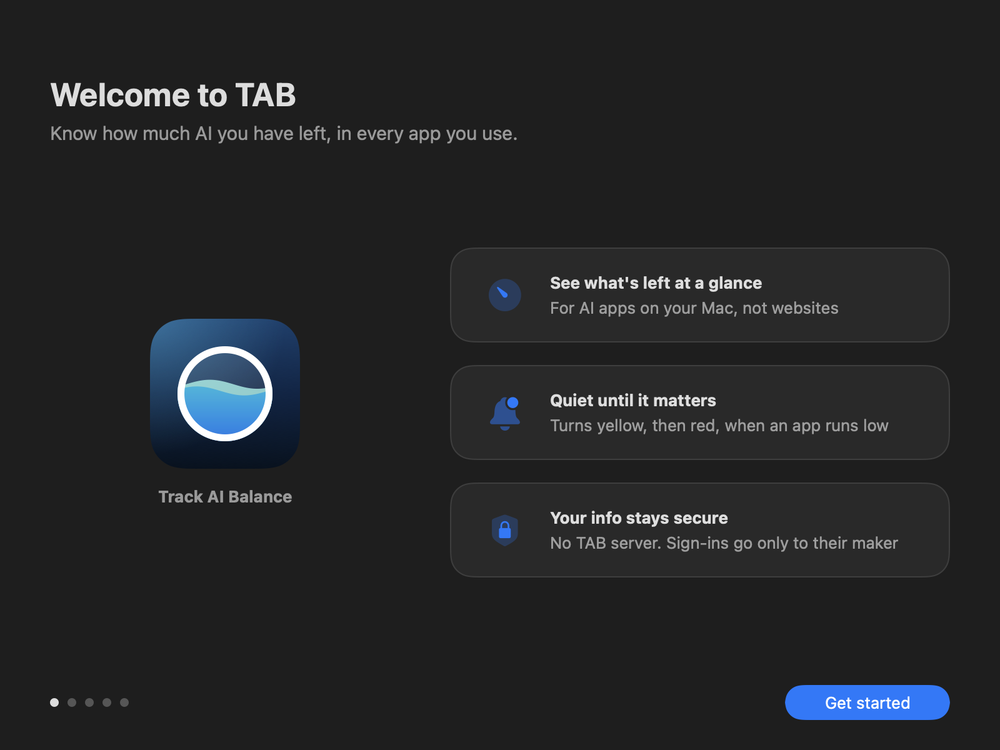
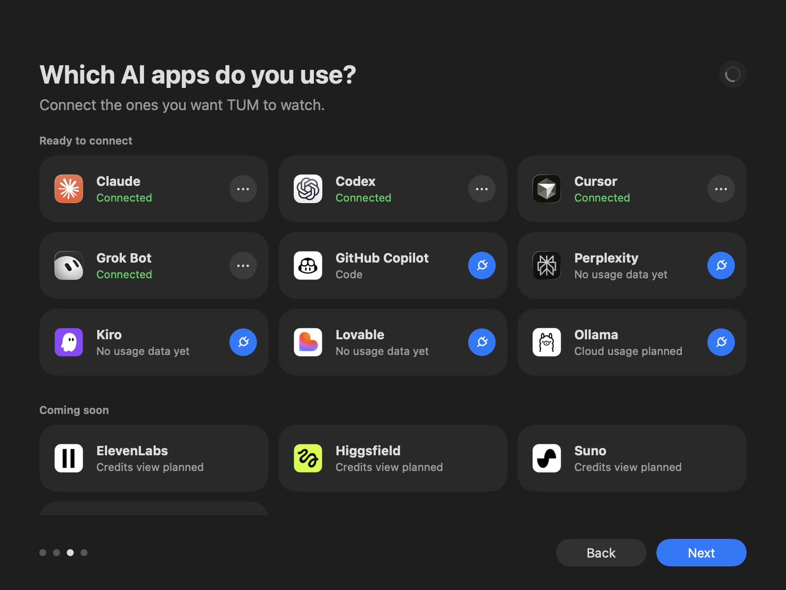
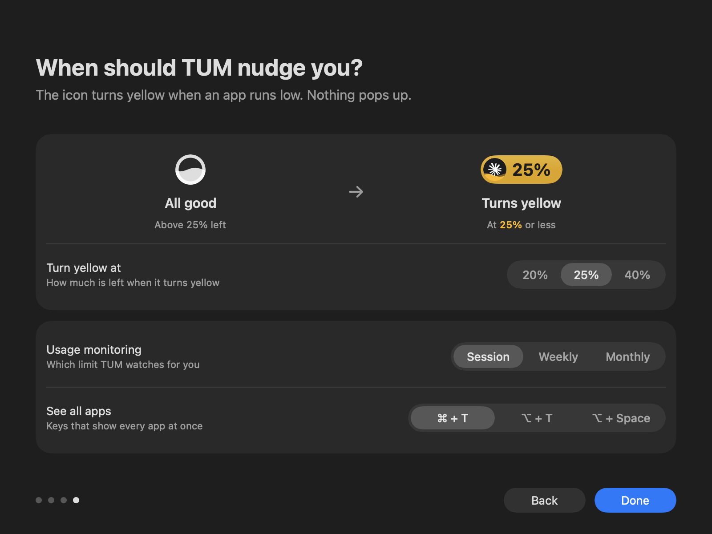
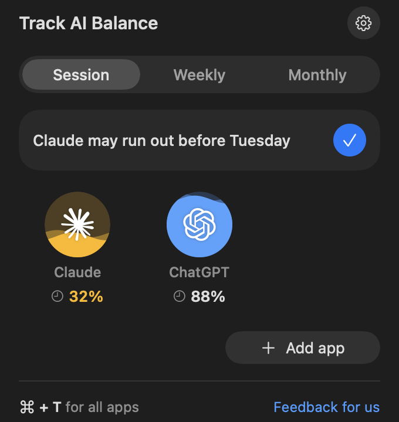
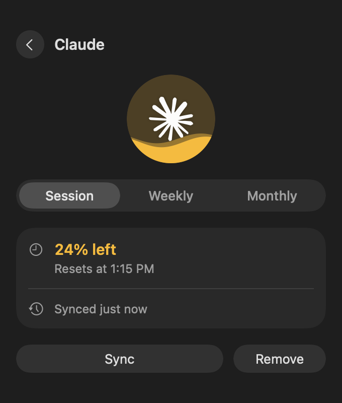
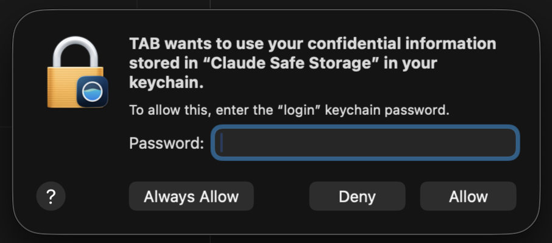

# TAB · Track AI Balance

TAB sits in your Mac's menu bar and keeps tabs on how much of your AI plan you have left. When an app runs low, its icon turns yellow, then red. When a limit is about to reset and you've barely used it, the icon turns green, so you can use it before it goes to waste.

TAB shows real numbers for Claude, ChatGPT, Cursor, Gemini, GitHub Copilot, Zed and Grok Bot, and for the Grok command-line tool. ChatGPT's limits are read through a Codex sign-in, so sign in to the Codex app or command-line tool once. If you have more than one Claude or ChatGPT account, TAB watches each one and uses the top one first.


When everything is fine, you see a small round icon. Yellow means an app is getting low (40% left or less, unless you change it). Red means it is almost out (25% or less). Green means not utilized enough. An app you've barely used has plenty left and resets soon, so use it before that goes to waste.

When several apps need you at once, red comes first, then yellow, then green. Apps of the same color take turns, about a minute each, so you see every one. Hover over the icon to see them all at once.

## What TAB supports today

- **Mac apps.** TAB works with AI apps installed on your Mac, like the Claude, ChatGPT and Cursor desktop apps and their command-line tools.
- **Web apps are next.** AI tools you mostly use in a browser, like ChatGPT, Perplexity, Higgsfield and ElevenLabs, are listed under On the web. Signing in to them on their own site is still being tested, so they say they aren't supported yet.
- **Windows is planned.** TAB runs on macOS today. A Windows version is on the way.

## Install

Open Terminal (press ⌘ Space, type Terminal, press Return), paste this line, press Return, then type `y`:

```bash
curl -fsSL https://raw.githubusercontent.com/araje-bot/TAB-Track-AI-Balance/v0.2.4/install.sh | bash
```

TAB opens with a short welcome and shows the AI apps it found. It needs macOS 13 or later, on Apple silicon or Intel.

Please install TAB this way, not from a downloaded file. TAB isn't signed by Apple yet, so macOS blocks it when it comes through a browser. The Terminal line installs it without that block.

To update, run the same line from this page again. Settings and connected apps stay.

TAB used to be called TUM. If you had TUM, the installer replaces it, and TAB brings over your settings and connected apps.

## A quick look

**Welcome.** TAB opens with a short tour the first time.



**Pick your AI apps.** TAB finds the ones on your Mac, and lists AI apps you use in a browser under On the web. Tap the plug to connect one. Only apps TAB can show real numbers for can be connected.



**Choose when to be nudged.** One slider sets two levels. The icon turns yellow at Getting low and red at Almost out. You see the change right away.



**Click the icon any time.** Each circle fills up to match what is left. It opens on the view you picked during setup, and you can switch between Session, Weekly and Monthly. Each tab shows only the apps that have that kind of limit. Click an app for more, and Sync to get its latest numbers. An app with two accounts shows a small 2, and you drag its accounts to choose which one TAB uses first.

<p>
  
  &nbsp;&nbsp;
  
</p>

## Uninstall

```bash
curl -fsSL https://raw.githubusercontent.com/araje-bot/TAB-Track-AI-Balance/v0.2.4/uninstall.sh | bash
```

Or drag TAB from Applications to the Trash.

## How TAB works

1. **It finds your AI apps.** TAB checks which supported apps are on your Mac.
2. **It uses the sign-in you already have.** Most AI apps keep you signed in on your Mac, and TAB uses that, so there is nothing new to log in to. For Cursor, and for GitHub Copilot when it isn't signed in yet, you sign in once in your browser. For Gemini, you sign in once on Google's own page in a small TAB window. That sign-in works for your whole Google account, so TAB sends it only to gemini.google.com. TAB keeps these sign-ins in your Mac's Keychain and deletes them when you remove the app. Cursor and Grok Bot share one, so it goes once both are removed.
3. **It asks each app's own company how much is left.** Claude's numbers come from Anthropic, ChatGPT's from OpenAI, and so on. TAB has no server, no account and no analytics, so nothing goes anywhere else, except feedback you choose to send.
4. **It shows the answer in your menu bar.** TAB checks again whenever you use an app, and every so often in between.

TAB only asks for usage numbers. It does not save your prompts, chats, files or code, and it does not change the sign-ins other apps keep.

## Why macOS asks for your password



Some AI apps, like Claude and Zed, save your sign-in in your Mac's Keychain, the locked safe macOS uses for passwords. When TAB connects one of them, macOS asks you first, because a new app wants to open that safe.

- **Your password goes to macOS, not to TAB.** This box comes from macOS itself. TAB never sees what you type.
- **Why TAB needs it.** TAB uses the sign-in your AI app already saved to ask that app's own company one thing, how much you have left. Claude's goes only to Anthropic, Zed's only to Zed. That answer is the number in your menu bar.
- **Choose Always Allow.** TAB checks again in the background whenever you use an app, so your numbers stay current without you doing anything. Always Allow lets it read that one item quietly from then on. Allow works only that one time, so the next check can't read it and TAB asks you to connect again. Deny means TAB can't show that app.
- **It goes nowhere else.** TAB has no server, no account and no analytics. The people who made TAB never see your sign-in or your usage. TAB doesn't change that sign-in or save a copy. It reads it only when it checks, and sends it nowhere but that app's company. The code is all here for anyone to check.

After a TAB update, macOS may ask once more, since it ties Always Allow to the exact version of the app.

## Good to know

- TAB never asks for your password. When you connect Gemini, you type it on Google's own sign-in page, shown in a small TAB window. TAB doesn't read or save your password. TAB does not need keyboard, screen or accessibility permissions.
- macOS may ask for your password once when you connect Claude or Zed. See [why](#why-macos-asks-for-your-password).
- The installer downloads one exact build from this repository and checks it against a fingerprint written into the script. A different file is deleted, not installed.
- All of TAB's code is in this repository, so anyone can read exactly what it does.

## Feedback

Click **Feedback for us** at the bottom of TAB (also in Settings) and type your note. It goes to the TAB team through Google Forms, with your TAB and macOS versions and the reply email if you add one. If you have a GitHub account, you can also open an issue here.

## License

Not chosen yet, so all rights reserved for now. TAB is a University of Maryland INST474 team project; an open-source license is planned.
